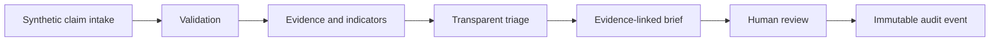

# Architecture overview

ClaimTriageLab follows a local-first modular monolith. The required runtime uses one Python process and a local SQLite database. LangGraph checkpoints each stage and pauses before a server-rendered reviewer action.

The offline baseline remains deterministic and measurable. Production workflow decisions use a configured Groq or Gemini model behind typed interfaces and cannot authorize claimant actions. The model selects allowlisted tools, Qdrant retrieves synthetic evidence, and deterministic validators enforce citations and output consistency. Source evidence remains separate from extracted facts and summaries.

## Task 06 durable workflow

The implemented route is intake → evidence → triage → brief → reviewer interrupt → complete. A stable `claim:{case_id}` thread key identifies each checkpoint stream. The review side effect occurs only after the interrupt resumes and uses the Task 05 idempotency key, so replay after a crash returns the same saved decision. The workflow service checks the reviewer role before resuming, and the tool registry checks it again at the write boundary.

The local page is available through `uv run claimtriagelab serve-reviewer`. It renders the latest checkpoint and exposes the three allowed review actions. The configured local reviewer identity is a development boundary; authenticated sessions and CSRF protection remain required before wider access.

## Task 01 state boundary

`WorkflowState` contains only `case_id`, `stage`, evidence and indicator IDs, a triage result ID, a pending review ID, errors, and version. Large documents, extracted facts, and reviewer decisions belong in persistent storage. A pending review stage requires a review ID. This narrow state can later be checkpointed and resumed without copying untrusted document text into graph messages.

The source contracts are in `src/claimtriagelab/domain/contracts.py`. They reject extra fields, malformed identifiers, negative amounts, reversed or timezone-free claim dates, duplicate document references, and triage outputs with uncited indicators. SQLite foreign keys bind stored evidence and review decisions to claims, while the rule pipeline builds indicator citations only from the current claim's evidence map.
