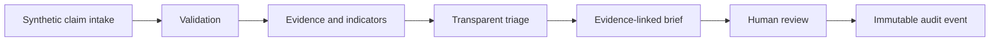

# Architecture overview

ClaimTriageLab follows a local-first modular monolith. The required runtime uses one Python process and a local SQLite database. Later phases add a server-rendered reviewer UI and a bounded LangGraph workflow for pause/resume behavior.

The baseline is deterministic and measurable. Optional local models operate behind typed interfaces and cannot authorize actions. Source evidence remains separate from extracted facts and summaries.

